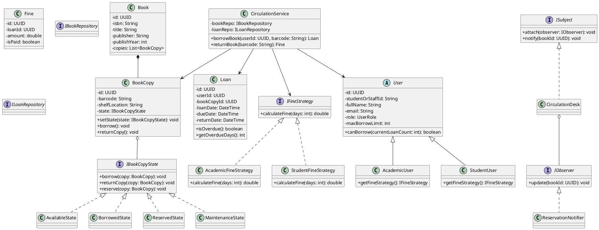
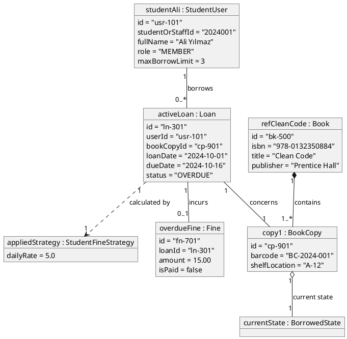
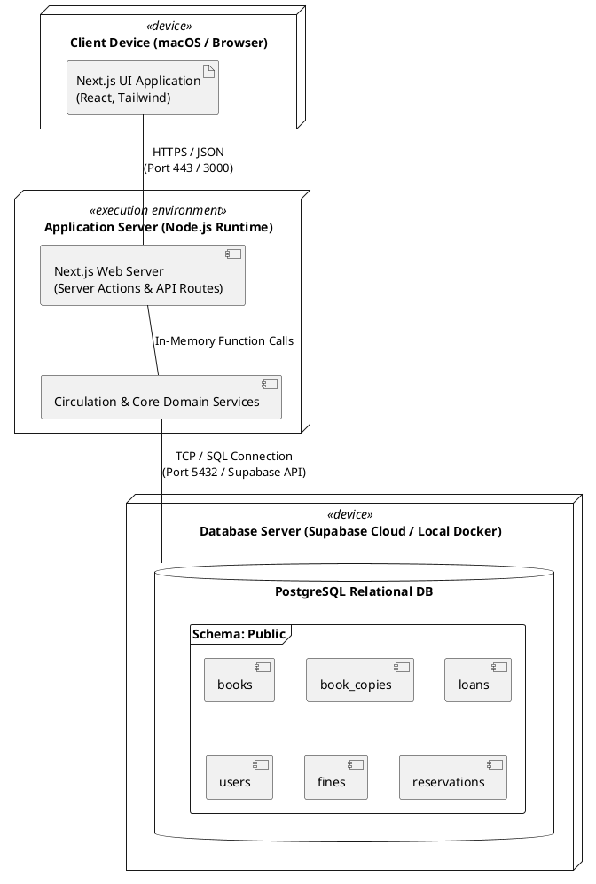

# KÜTÜPHANE YÖNETİM VE OTOMASYON SİSTEMİ
## Yazılım Tasarımı ve Mimarisi Dersi Kapsamlı Proje Spesifikasyonu

---

## 1. GİRİŞ VE SİSTEM GENEL BAKIŞI

Bu doküman, Yazılım Tasarımı ve Mimarisi dersi gereksinimleri uyarınca; nesne yönelimli analiz/tasarım (OOAD) ilkeleri, kurumsal mimari kalıpları (N-Tier / Layered Architecture) ve modern yazılım mühendisliği pratikleri gözetilerek tasarlanan **Kütüphane Yönetim ve Otomasyon Sistemi**'nin uçtan uca mimari şartnamesidir.

Sistem, fiziksel kütüphane envanterinin takibi, üye hakları yönetimi (Rol ve Üyelik Tipi tabanlı yetkilendirme), sirkülasyon süreçleri (ödünç alma, iade, süre uzatma), rezervasyon kuyruğu ve dinamik gecikme cezası hesaplama mekanizmalarını bünyesinde barındırır. Dokümanın tüm bölümleri, geliştirme safhasında kod üretimine ve teslim aşamasında A3 kağıdına çizilecek **Class, Object ve Deployment** diyagramlarına doğrudan temel teşkil edecek standartta yapılandırılmıştır.

---

## 2. TEKNOLOJİ YIĞINI VE SEÇİM GEREKÇELERİ

Geliştirme ortamı (macOS) ve dersin gereksinimleri (modern mimari, platform bağımsızlık, yüksek prototipleme hızı) doğrultusunda teknoloji yığını şu şekilde kesinleştirilmiştir:

| Katman | Teknoloji | Seçim Gerekçesi |
| :--- | :--- | :--- |
| **Geliştirme Dili** | TypeScript (Strict Mode) | Tip güvenliği, OOP arayüz/soyutlama desteği ve hatasız domain modelleme. |
| **Ön Yüz (Presentation)** | Next.js (App Router), React, Tailwind CSS | Hızlı bileşen mimarisi, zengin form/tablo desteği ve yerel Server Actions entegrasyonu. |
| **İkonografi & UI Kit** | Lucide React, Radix UI / Shadcn UI | Kütüphaneci ekranları için sade ve okunabilir gösterge panelleri. |
| **İş & Servis Katmanı** | Pure TypeScript (Node.js runtime) | Framework'ten bağımsız çalışabilen saf iş kuralları (Business Logic). |
| **Veri Tabanı (RDBMS)** | PostgreSQL (Supabase / Yerel Docker) | ACID uyumluluğu, gelişmiş Foreign Key ve Enum bütünlüğü desteği. |
| **Veri Erişim (DAL)** | Kysely / Prisma / Supabase JS Client | Repository pattern için tip korumalı SQL sorgu inşası. |
| **Diyagram Çıktıları** | PlantUML / Mermaid | A3 çizimlerine dönüştürülebilir deklaratif UML formatı. |

---

## 3. KURUMSAL YAZILIM MİMARİSİ (N-TIER / LAYERED ARCHITECTURE)

Sistem katı bir katman ayrımı (Separation of Concerns) ile kurgulanmıştır. Katmanlar arası bağımlılıklar yalnızca yukarıdan aşağıya veya arayüzler (Interfaces) aracılığıyla içe doğru gerçekleşir (Dependency Inversion).

```
+-------------------------------------------------------------------+
|               PRESENTATION LAYER (Next.js / UI)                   |
|  - Dashboard View   - Circulation Desk (Ödünç/İade)   - Catalog   |
|  - Members & Fines  - Server Actions & API Route Handlers         |
+---------------------------------+---------------------------------+
                                  | calls
                                  v
+-------------------------------------------------------------------+
|                 APPLICATION / SERVICE LAYER                       |
|  - CirculationService  - CatalogService  - MemberService          |
|  - FineCalculatorService (Strategy Context)                       |
+---------------------------------+---------------------------------+
                                  | depends on abstractions
                                  v
+-------------------------------------------------------------------+
|                     CORE DOMAIN LAYER                             |
|  - Entities: User, Book, BookCopy, Loan, Fine, Reservation        |
|  - State Pattern: IBookCopyState (Available, Borrowed, etc.)      |
|  - Strategy Pattern: IFineCalculationStrategy                     |
|  - Observer Pattern: ISubject, IObserver (ReservationNotifier)    |
|  - Interfaces: IBookRepository, ILoanRepository, IUnitOfWork      |
+---------------------------------+---------------------------------+
                                  ^ implements
                                  |
+-------------------------------------------------------------------+
|                 INFRASTRUCTURE LAYER (DAL & DB)                   |
|  - Supabase/PostgreSQL Connection Pool                            |
|  - Concrete Repositories (BookRepo, LoanRepo, UserRepo)           |
|  - UnitOfWork Implementation & State/Strategy Mappers             |
+-----------------------------------+
```

---

## 4. TASARIM DESENLERİ (DESIGN PATTERNS) VE MİMARİ ENTEGRASYON

### 4.1. State Pattern (Kopya Yaşam Döngüsü Yönetimi)
* **Kullanım Amacı:** `BookCopy` (Fiziksel Kopya) nesnesinin durum değişikliklerini (`Available`, `Borrowed`, `Reserved`, `Maintenance`, `Lost`) spagetti `if-else` kontrolleri yerine durum sınıfları üzerinden yönetmek.
* **Arayüz (`IBookCopyState`):**
  * `borrow(context: BookCopy): void`
  * `returnCopy(context: BookCopy): void`
  * `reserve(context: BookCopy): void`
  * `sendToMaintenance(context: BookCopy): void`
* **Somut Durumlar (Concrete States):**
  * `AvailableState`: Yalnızca `borrow()` ve `reserve()` edilebilir. `returnCopy()` çağrılırsa hata fırlatır.
  * `BorrowedState`: Yalnızca `returnCopy()` edilebilir. Tekrar ödünç verilemez.
  * `ReservedState`: Yalnızca rezervasyon sahibi tarafından ödünç alınabilir veya iptal edilebilir.
  * `UnderMaintenanceState`: Tamir/ciltleme bitene kadar hiçbir sirkülasyona dahil edilemez.

### 4.2. Strategy Pattern (Dinamik Ceza Hesaplama)
* **Kullanım Amacı:** Öğrenci, akademisyen veya standart üyelerin gecikmiş kitap iadelerinde farklı günlük ceza katsayılarının OCP (Open/Closed Principle) kuralına uygun işletilmesi.
* **Arayüz (`IFineCalculationStrategy`):**
  * `calculateFine(daysOverdue: number): number`
* **Somut Stratejiler:**
  * `StudentFineStrategy`: Günlük 5.00 TL ceza uygular.
  * `AcademicFineStrategy`: Günlük 2.00 TL toleranslı ceza uygular.
  * `StandardFineStrategy`: Günlük 10.00 TL tam tarife ceza uygular.

### 4.3. Observer Pattern (İade ve Rezervasyon Bildirim Mekanizması)
* **Kullanım Amacı:** Ödünçteki bir kitap kopyası kütüphaneye iade edildiğinde, bu kitap için sırada bekleyen ilk rezervasyon sahibine otomatik bildirim oluşturulması ve kopyanın rezerve durumuna çekilmesi.
* **Bileşenler:**
  * `ISubject`: `attach(observer)`, `detach(observer)`, `notify(eventData)`.
  * `IObserver`: `update(eventData)`.
  * `ReservationNotifier`: İade olayını dinler, aktif rezervasyon kuyruğunu sorgular ve sıradaki üyeye bildirim kaydı açar.

### 4.4. Repository & Unit of Work Pattern
* **Kullanım Amacı:** Veritabanı CRUD operasyonlarını domain katmanından izole etmek ve çoklu adımlı işlemleri tek bir transaction sınırında tutmak.

---

## 5. İLİŞKİSEL VERİTABANI ŞEMASI (POSTGRESQL / SUPABASE DDL)

```sql
-- GEREKLİ ENUM TİPLERİ
CREATE TYPE user_role AS ENUM ('ADMIN', 'LIBRARIAN', 'MEMBER');
CREATE TYPE user_type AS ENUM ('STUDENT', 'ACADEMIC', 'STANDARD');
CREATE TYPE copy_status AS ENUM ('AVAILABLE', 'BORROWED', 'RESERVED', 'MAINTENANCE', 'LOST');
CREATE TYPE loan_status AS ENUM ('ACTIVE', 'RETURNED', 'OVERDUE');

-- 1. KULLANICILAR TABLOSU
CREATE TABLE users (
    id UUID PRIMARY KEY DEFAULT gen_random_uuid(),
    student_or_staff_id VARCHAR(50) UNIQUE NOT NULL,
    full_name VARCHAR(150) NOT NULL,
    email VARCHAR(150) UNIQUE NOT NULL,
    role user_role NOT NULL DEFAULT 'MEMBER',
    user_type user_type NOT NULL DEFAULT 'STUDENT',
    max_borrow_limit INT NOT NULL DEFAULT 3,
    created_at TIMESTAMP WITH TIME ZONE DEFAULT NOW()
);

-- 2. KATEGORİ VE YAZARLAR
CREATE TABLE categories (
    id SERIAL PRIMARY KEY,
    name VARCHAR(100) UNIQUE NOT NULL,
    shelf_prefix VARCHAR(10) NOT NULL
);

CREATE TABLE authors (
    id SERIAL PRIMARY KEY,
    full_name VARCHAR(150) NOT NULL,
    biography TEXT
);

-- 3. KİTAP METAVERİSİ (BOOK TİPİ)
CREATE TABLE books (
    id UUID PRIMARY KEY DEFAULT gen_random_uuid(),
    isbn VARCHAR(20) UNIQUE NOT NULL,
    title VARCHAR(255) NOT NULL,
    category_id INT REFERENCES categories(id) ON DELETE SET NULL,
    publisher VARCHAR(150) NOT NULL,
    publish_year INT NOT NULL,
    page_count INT NOT NULL,
    description TEXT,
    created_at TIMESTAMP WITH TIME ZONE DEFAULT NOW()
);

CREATE TABLE book_authors (
    book_id UUID REFERENCES books(id) ON DELETE CASCADE,
    author_id INT REFERENCES authors(id) ON DELETE CASCADE,
    PRIMARY KEY (book_id, author_id)
);

-- 4. FİZİKSEL ENVANTER KOPYALARI (BOOK_COPY TİPİ)
CREATE TABLE book_copies (
    id UUID PRIMARY KEY DEFAULT gen_random_uuid(),
    book_id UUID NOT NULL REFERENCES books(id) ON DELETE CASCADE,
    barcode VARCHAR(50) UNIQUE NOT NULL,
    shelf_location VARCHAR(50) NOT NULL,
    status copy_status NOT NULL DEFAULT 'AVAILABLE',
    condition_notes TEXT,
    created_at TIMESTAMP WITH TIME ZONE DEFAULT NOW()
);

-- 5. SİRKÜLASYON İŞLEMLERİ (LOANS)
CREATE TABLE loans (
    id UUID PRIMARY KEY DEFAULT gen_random_uuid(),
    user_id UUID NOT NULL REFERENCES users(id) ON DELETE RESTRICT,
    book_copy_id UUID NOT NULL REFERENCES book_copies(id) ON DELETE RESTRICT,
    loan_date TIMESTAMP WITH TIME ZONE DEFAULT NOW(),
    due_date TIMESTAMP WITH TIME ZONE NOT NULL,
    return_date TIMESTAMP WITH TIME ZONE,
    status loan_status NOT NULL DEFAULT 'ACTIVE'
);

-- 6. GECİKME CEZALARI (FINES)
CREATE TABLE fines (
    id UUID PRIMARY KEY DEFAULT gen_random_uuid(),
    loan_id UUID UNIQUE NOT NULL REFERENCES loans(id) ON DELETE CASCADE,
    user_id UUID NOT NULL REFERENCES users(id) ON DELETE RESTRICT,
    amount NUMERIC(10, 2) NOT NULL DEFAULT 0.00,
    is_paid BOOLEAN NOT NULL DEFAULT FALSE,
    calculated_at TIMESTAMP WITH TIME ZONE DEFAULT NOW(),
    paid_at TIMESTAMP WITH TIME ZONE
);

-- 7. REZERVASYON KUYRUĞU (RESERVATIONS)
CREATE TABLE reservations (
    id UUID PRIMARY KEY DEFAULT gen_random_uuid(),
    user_id UUID NOT NULL REFERENCES users(id) ON DELETE CASCADE,
    book_id UUID NOT NULL REFERENCES books(id) ON DELETE CASCADE,
    queue_number INT NOT NULL,
    created_at TIMESTAMP WITH TIME ZONE DEFAULT NOW(),
    is_active BOOLEAN NOT NULL DEFAULT TRUE
);

-- 8. DENETİM VE GÜVENLİK GÜNLÜĞÜ (AUDIT LOGS)
CREATE TABLE audit_logs (
    id UUID PRIMARY KEY DEFAULT gen_random_uuid(),
    user_id UUID REFERENCES users(id),
    action VARCHAR(100) NOT NULL,
    entity_name VARCHAR(50) NOT NULL,
    entity_id VARCHAR(50) NOT NULL,
    details JSONB,
    timestamp TIMESTAMP WITH TIME ZONE DEFAULT NOW()
);
```

---

## 6. SİSTEM FONKSİYONLARI VE KULLANIM SENARYOLARI (USE CASES)

* `borrowBook(userId: string, barcode: string)`:
  - Borç kontrolü $\rightarrow$ Kota kontrolü $\rightarrow$ `BookCopy.state.borrow()` tetiklemesi $\rightarrow$ `Loan` kaydı ve `BORROWED` güncellemesi.
* `returnBook(barcode: string)`:
  - Gecikme süresi hesabı $\rightarrow$ Kullanıcı tipine göre dinamik `Strategy` ile ceza hesabı $\rightarrow$ `BookCopy.state.returnCopy()` $\rightarrow$ `Observer` ile rezervasyon kontrolü.
* `extendLoan(loanId: string)`:
  - Aktif rezervasyon ve gecikme cezası yoksa `due_date` uzatımı (+7 gün).
* `searchCatalog(query, filters)`:
  - Çok kriterli kitap ve mevcut kopya durumu arama.
* `payFine(fineId: string)`:
  - Tahsilat makbuzu kaydı ve üye kısıtlamasının kaldırılması.

---

## 7. PROJE KLASÖR YAPISI VE KOD YERLEŞİMİ

```text
library-automation/
├── package.json
├── tsconfig.json
├── tailwind.config.js
├── next.config.js
├── src/
│   ├── core/                               # Saf Domain Katmanı
│   │   ├── entities/                       # User, Book, BookCopy, Loan, Fine, Reservation
│   │   ├── patterns/
│   │   │   ├── state/                      # IBookCopyState, Available, Borrowed, Reserved...
│   │   │   ├── strategy/                   # IFineStrategy, Student, Academic, Standard...
│   │   │   └── observer/                   # EventManager, ReservationNotifier
│   │   └── interfaces/                     # IRepository, IUnitOfWork, IBookRepository...
│   ├── infrastructure/                     # Veri Tabanı ve Somut Repolar
│   │   ├── db/                             # supabaseClient.ts, schema.sql
│   │   └── repositories/                   # BookRepository, LoanRepository, UserRepository...
│   ├── services/                           # CirculationService, CatalogService, MemberService
│   ├── components/                         # QuickDeskPanel, BookTable, AddBookModal...
│   └── app/                                # Next.js Pages (Dashboard, circulation, catalog, members)
```

---

## 8. ANTIGRAVITY İLE ADIM ADIM GELİŞTİRME PLANI

1. **Faz 1: Core Domain ve Tasarım Desenleri:** Saf TypeScript modelleri, State, Strategy ve Observer sınıfları.
2. **Faz 2: Veritabanı ve Altyapı:** Supabase şeması, tohum veriler (seed), somut repository sınıfları.
3. **Faz 3: Servis Katmanı:** Ödünç alma, iade, kota, dinamik ceza ve rezervasyon bildirim orkestrasyonu.
4. **Faz 4: Ön Yüz (Next.js & Tailwind):** Hızlı işlem masası, katalog tablosu ve dashboard metrikleri.

---

## 9. A3 DİYAGRAMLARI REFERANS MODELLERİ (PLANTUML)

A3 kağıdına çizilecek 3 diyagramın kod tabanıyla birebir uyumlu PlantUML şemaları:

### 9.1. Class Diagram (Sınıf Diyagramı)



### 9.2. Object Diagram (Nesne Diyagramı - Runtime Snapshot)

Bu diyagram, sistemin çalışma anında belirli bir ödünç alma ve gecikme cezası durumundaki somut nesne örneklerini (instances) ve aralarındaki referansları gösterir:



### 9.3. Deployment Diagram (Dağıtım Diyagramı)

